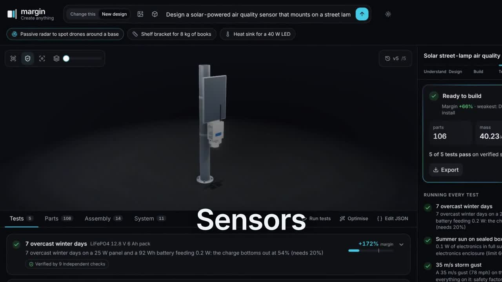
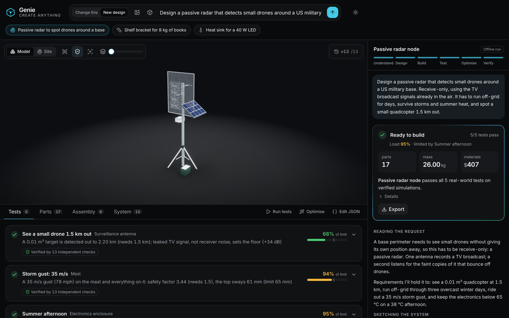

<p align="center">
  <picture>
    <source media="(prefers-color-scheme: dark)" srcset="docs/brand/logo-dark.svg">
    
  </picture>
</p>

<p align="center"><b>Describe anything. Margin designs it, tests it against the real world on
simulations that check themselves, and improves it until it passes with margin to spare.</b></p>

<p align="center">
  <a href="https://github.com/print-EddyMa/margin/actions/workflows/ci.yml"></a>
  
  
  <a href="LICENSE"></a>
  
</p>

<p align="center">
  
  
  
  
  
  
  
  
  
  
</p>

<p align="center">
  <a href="docs/media/margin-demo.mp4"></a><br>
  <a href="docs/media/margin-demo.mp4"><b>▶ Watch the 2-minute demo</b></a>
</p>



## Try it in a minute

Python 3.10 or newer. The web interface ships prebuilt, so Node is not needed.

```bash
git clone https://github.com/print-EddyMa/margin.git
```

```bash
cd margin
```

```bash
pip install -e ".[agent]"
```

```bash
margin serve
```

Open http://127.0.0.1:8000 and click a suggested request. Without an API key
the design steps are recorded and every simulation runs live (marked "Offline
run"). To design anything from your own words or photos, set your key before
starting the server:

```bash
export ANTHROPIC_API_KEY="your-key"
```

Everything also works from the terminal:

```bash
margin demo drone_radar
```

```bash
margin design "A wall bracket that holds a 5 kg speaker 20 cm off the wall" -o bracket.json
```

```bash
margin optimise examples/designs/shelf_bracket.json -o improved.json
```

## Inspiration

Ask an AI model to design a bracket, a heat sink or a radar and you get
confident numbers that nobody checked. Engineers don't trust a result until it
has been tested against physics, and for good reason. We wanted the speed of
asking an AI with the trust of a verified simulation: the model does the
design thinking, and every number comes from a simulation that proves it got
the physics right.

## What it does

You describe something, attach a photo, or import an STL. Margin:

1. writes a short engineering brief with numbers the design will be held to;
2. sketches the system as a block diagram, then builds the parts in 3D:
   materials, dimensions, where each sits, how they go together;
3. puts the design through the real world: wind, sun, fire, current, drops,
   heat, vibration, flow, radio coverage. Each test is a real numerical
   simulation that verifies itself (grid convergence, known solutions,
   conservation laws, units);
4. fixes what fails. A failure that needs a new idea (a missing part, the
   wrong layout) is fixed in the design, citing the number that showed it. A
   failure about size or material goes to an optimiser that keeps only changes
   the simulations prove, then trims excess material;
5. reports every result as a **margin of safety**, with the command that
   reproduces it, and calls the design ready only when every test passes on
   verified simulations.

You watch all of it happen live: the reasoning, the diagram drawing itself,
parts appearing in 3D, tests resolving, the optimiser's before-and-after.

### Example: a passive radar to spot drones

> Design a passive radar that detects small drones around a US military base.
> Receive-only, using the TV broadcast signals already in the air. It has to
> run off-grid for days, survive storms and summer heat, and spot a small
> quadcopter 1.5 km out.

- The first design passes 1 of 5 tests. Detection reaches only 0.75 km, and
  the simulation shows why: TV signal leaking into the back of the
  surveillance antenna raises the noise floor by 44 dB. A bigger antenna would
  not help, because it hears the leak just as loudly.
- A wire-mesh screen between the antenna and the transmitter fixes it:
  detection reaches 2.2 km.
- The optimiser paints the enclosure white (64 °C inside instead of 71 °C),
  enlarges the battery for three cloudy winter days and stiffens the mast for
  a 35 m/s gust, then trims material while every test keeps at least +5% margin.

The model is the public bistatic radar equation in free space, with
catalogue-level parts.

We then built the node's screen frame from Margin's design and tested it
outdoors with a quadcopter (field footage is in the demo video).

### More examples, each designed from one sentence

Claude designed each of these live in Margin, with every visible component as
its own part, and each passes all of its real-world tests. Open one with
**Edit JSON** in the app, or test it from the terminal with
`margin evaluate examples/designs/<file>`.

| Design | Parts | Tests | File |
|---|---|---|---|
| Survey quadcopter (300 g camera, 25 min flight, hard landings) | 105 | 6 / 6 | `survey_quadcopter.json` |
| Desktop robot arm (1 kg at 40 cm reach) | 105 | 6 / 6 | `robot_arm.json` |
| Rugged smartwatch (1.5 m drop onto concrete, 1 A charging) | 89 | 6 / 6 | `field_smartwatch.json` |
| 24 V, 20 A go-kart motor driver board | 91 | 3 / 3 | `kart_motor_driver.json` |
| Solar air-quality sensor for a lamp post | 106 | 5 / 5 | `air_quality_sensor.json` |

## How we built it

- **A self-checking simulation library** (Python, NumPy, SciPy): 32
  simulations on solvers written for this project: finite volumes for heat,
  diffusion, electrostatics and magnetostatics; beam and plane-stress finite
  elements; a projection-method Navier-Stokes solver; 1-D and 2-D FDTD for
  electromagnetic waves; thermal networks with radiation. Every run produces a
  verification report; a result that fails its own checks is never shown as a
  pass.
- **Real-world tests** that map a part onto those simulations (a bracket arm
  becomes a cantilever, a hollow section the rectangle of equal stiffness) and
  turn the answer into a margin of safety. A `simulation` test type binds any
  of the 32 simulations to a part's dimensions and material.
- **The designer agent** on Claude Opus 5.5 with tool use: set the diagram,
  set or edit the design, run the tests, optimise. It reads every test result
  and failed self-check, and is told never to present an unverified number.
- **A live event stream** from a standard-library Python server to a React 19
  interface with three.js (React Three Fiber), shadcn/ui, Magic UI and React
  Flow. The same stream drives live runs and recorded ones.
- **259 tests**, including tests that inject wrong units, unstable time steps,
  missing supports and wrong physics and require the matching check to fail.

## Challenges we ran into

- **The optimiser found a loophole.** Asked to cut mass while keeping an
  enclosure cool, it shrank the box until the electronics no longer fitted
  inside, so there was no heat left to test. We added a containment rule: a
  housing can never shrink below what it holds.
- **A bigger antenna didn't help the radar.** The first instinct was more
  gain. The simulation showed the receiver was limited by TV signal leaking
  into the back of the antenna, which a bigger antenna hears just as loudly.
  The fix was geometry: a mesh screen. Getting the model honest enough to
  show that took the leakage term, the antenna pattern and the exact bistatic
  geometry.
- **Verified and fast.** Every test runs a three-grid convergence study, yet
  the whole radar design (five tests, an optimiser that evaluates dozens of
  candidates, then a fully verified final run) computes in about 3 seconds.
- **Two versions at once.** A parallel branch rebuilt the same features under
  another name; we merged its best ideas (load metrics, design editing,
  any-simulation tests) and kept one codebase.

## Accomplishments we're proud of

- 32 simulations that check themselves, each against an exact or benchmark
  solution (including Ghia et al.'s cavity-flow data at Re 100, 400 and 1000).
- Every number in the interface can be re-run on its own from the command
  that produced it.
- A design process you can watch, where the AI's decisions are always backed
  by physics it didn't compute itself.

## What we learned

The model is very good at the parts engineers find tedious (choosing parts,
laying them out, deciding what to test) and should never be trusted with the
arithmetic. Splitting the work that way, and making the checks impossible to
skip, is what makes the output usable.

## What's next

- 3-D finite elements on the real shape, beyond beam and wall idealisations.
- Terrain and multipath in the radar model; flame spread in the fire test.
- Measured dimensions from photos with a reference object, and STEP export.
- Supplier datasheets in place of handbook material values.

## Margin of safety

Every result is reported the way aerospace and defence engineers report it:

**margin of safety = allowable / actual - 1**

A margin of +47% means 47% to spare. 0% is exactly at the limit; a negative
margin fails. For a safety factor or a detection range, "allowable" is the
requirement; for a temperature, margins are measured on the rise above the
surroundings. A design's margin is that of its weakest test, and the optimiser
never trims a passing design below +5%.

## Real-world tests

| Test | What it answers | Simulation behind it |
|---|---|---|
| `load` | Does it hold a weight, and how far does it bend? | `beam` (finite elements) |
| `drop` | Does it survive a fall or an impact? | `drop_impact` |
| `vibration` | Will it resonate with a motor or fan? | `beam_vibration` |
| `wind` | Does a mast or pole survive a gust, with everything on it? | `beam` |
| `heat` | How hot does a heat sink or a rod get? | `heat_sink_fin` |
| `fire` | How long before a flame ignites or softens it? | `flame_exposure` |
| `enclosure` | How hot is it inside a sealed box in the sun? | `enclosure_thermal` |
| `current` | How hot does a conductor get, and what voltage is lost? | `wire_heating` |
| `power` | Does a solar panel and battery keep it on through bad weather? | `solar_battery` |
| `flow` | What pressure does a pipe lose? | `pipe_flow` |
| `coverage` | How far out can a passive radar see a target? | `passive_radar` |

A part is idealised for each test (a bracket arm becomes a beam, a hollow
section becomes the rectangle of equal stiffness), and every idealisation is
listed in that test's notes.

## How every number is checked

Every run produces a report. Each line is `PASS`, `WARN`, `FAIL` or `skip`,
with the numbers behind it. A check that does not apply is listed as skipped
with the reason; it is never left out.

### Every simulation

| Check | What actually happens |
|---|---|
| **Mesh convergence** | The problem is solved on three grids (n/4, n/2, n). Richardson extrapolation gives the observed order of accuracy and an estimate of the error left in the answer. Above 2% is a warning, above 6% a failure. |
| **Dimensional analysis** | Every input is parsed with its unit and converted; a wrong dimension stops the run. Each simulation also lists the terms of its governing equation as dimensioned quantities, and they must all match. Named groups (Reynolds, Biot, Peclet...) must come out as pure numbers. |
| **Known solutions** | The result is compared with the exact answer where one exists (fin equation, beam formulas, Hagen-Poiseuille, Fresnel slab, layered cylinder...). Where the setup has no closed form, the same solver is run on a benchmark that does. |
| **Residuals** | The relative residual of the discrete equations must be below tolerance (1e-8 for linear solves). |

### By physics

| Physics | Checks |
|---|---|
| **Heat and thermodynamics** | Energy in = energy out + stored, summed from the boundary formulas. No temperature below the coldest boundary or above the hottest source (maximum principle), applied only where the signs of the sources make it a theorem. Entropy production is non-negative. The result agrees with, or is bracketed by, a back-of-envelope R-network. |
| **Structures** | Sum of forces and sum of moments are zero. Reactions equal the applied loads. Deflection and stress match the beam-theory formula in the standard cases. |
| **Fluids** | Mass in = mass out. The Reynolds number is compared with the regime the model assumes, and a laminar model at a turbulent Reynolds number is flagged. Pressure drop matches Hagen-Poiseuille (laminar) or the Moody chart via Colebrook (turbulent). |
| **Electromagnetism** | Div B = 0. Charge is conserved. Gauss's law holds over nested closed surfaces. Energy flow adds up: Poynting flux in = out + absorbed. |

### Math sanity

| Check | What actually happens |
|---|---|
| **Well-posed** | Before solving: boundary conditions are complete and consistent. A steady problem with only flux conditions and a net source has no solution and is rejected; a structure that can move as a rigid body is rejected. |
| **CFL** | For time stepping, the step is compared with the stability limit of the scheme. An unstable step fails here, as well as in every check its blow-up breaks. |
| **Symmetry** | If the setup is unchanged by a reflection, the solution must be too. |

The checks are tested the same way as the solvers: the test suite injects
wrong units, unstable time steps, missing supports and wrong physics, and
requires the matching check to fail.

## Simulations in the engine

Margin runs on Simulate Anything, a library of 32 simulations that
verify themselves. Each one can also be run on its own:

| Area | Simulations |
|---|---|
| Real-world tests | `flame_exposure`, `wire_heating`, `drop_impact`, `passive_radar`, `enclosure_thermal`, `solar_battery` |
| Electronics | `pcb_thermal`, `heat_sink_fin`, `battery_pack` |
| Mechanical | `beam`, `plate_stress`, `beam_vibration` |
| Fluids | `channel_flow`, `lid_driven_cavity`, `pipe_flow`, `projectile_drag`, `cooling_channel` |
| Electromagnetics | `antenna_array`, `magnetostatics`, `capacitor`, `em_shield` |
| Aerospace | `cubesat_thermal`, `reentry_heating` |
| Bio and medicine | `drug_diffusion`, `implant_heating` |
| Climate and energy | `groundwater_well`, `wall_heat_loss`, `solar_panel`, `fuel_pin` |
| Chemistry | `reaction_diffusion`, `plug_flow_reactor` |
| Education | `conduction_2d` |

```bash
python -m simulate_anything run passive_radar -p rcs="0.01 m^2" --html report.html
```

```bash
python -m simulate_anything serve
```

New simulations are one class each; see [docs/extending.md](docs/extending.md).

## Limits

- Geometry is built from primitives (boxes, tubes, rods, fins, antennas) and
  imported STL meshes. Tests idealise parts as beams, walls, rods and lumped
  boxes; they do not run 3-D finite elements on the full shape.
- Fire means heating to ignition or softening; flame spread and burning are
  not modelled. Flow is laminar except turbulent pipe friction.
- The passive radar model is free space over flat ground: no terrain,
  multipath, or clutter other than the direct signal.
- A photo gives proportions, not measurements. Dimensions from a photo are
  estimates unless something of known size is in the picture.
- A clean report means the equations as posed were solved correctly. It does
  not prove the equations are the right model of your hardware.

## Layout

```
create_anything/      designs, real-world tests, optimiser, agent, live engine, server
  web/dist/           the built interface (served by the Python server)
web/                  interface source (React, three.js)
simulate_anything/    the self-checking simulation library
examples/designs/     example designs (JSON), ready to evaluate or optimise
docs/                 protocol, extending guide, brand, credits, demo video (docs/media)
video/                source of the demo video (Remotion composition, app capture scripts)
tests/
```

## Development

```bash
pip install -e ".[dev,agent]"
```

```bash
python -m pytest
```

```bash
cd web && npm install && npm run build
```

## Built with

Claude Opus 5.5 (Anthropic) for the designer agent; NumPy and SciPy for the
engine; React, TypeScript, Vite, Tailwind CSS, three.js (React Three Fiber,
drei, postprocessing), shadcn/ui, Magic UI, React Flow, Motion and Zustand for
the interface; Inter and JetBrains Mono typefaces. The demo video was cut in
Remotion from real app captures (Playwright), with AI footage, narration and
sound effects generated on Higgsfield. The full list with
licenses, the data used and the published methods behind each simulation is
in [docs/CREDITS.md](docs/CREDITS.md).

## Team

Eddy Ma ([@print-EddyMa](https://github.com/print-EddyMa))

## License

[MIT](LICENSE)
